<div align="center">


<a href="https://git.io/typing-svg"></a>

<p>
  <a href="https://hossamali.me"></a>
  <a href="https://linkedin.com/in/hossamali6"></a>
  <a href="https://x.com/hossamali66"></a>
  <a href="mailto:hossam.anber6@gmail.com"></a>
  <a href="https://tryhackme.com/p/hossamali"></a>
</p>


</div>

---

## 👋 About me


I'm **Hossam Ali**, a self-taught **backend developer** from Egypt 🇪🇬 specialized in **Laravel & PHP**, with a strong focus on **cybersecurity**.

I build secure, scalable backend systems — and I like to understand how those systems behave under real-world load and real-world attacks.

- 🔧 Building **REST APIs**, admin dashboards and data-driven platforms with Laravel
- 🔐 Designing **authentication, authorization & RBAC** (Passport, Sanctum, 2FA)
- 🛡️ **Log analysis & attack investigation** — brute-force, suspicious activity, hardening
- 🧪 Practicing hands-on on **TryHackMe** & security labs
- 💼 **Open for freelance** backend work — [drop me an email](mailto:hossam.anber6@gmail.com)

<br clear="right" />

---

## 🧰 Tech stack

<p align="center">
  <br/>
  
</p>

<div align="center">

| Backend | Security | Data | Tooling |
|:--|:--|:--|:--|
| Laravel · PHP 8 · REST APIs | Auth & RBAC · 2FA · OWASP Top 10 | MySQL · SQLite · Eloquent | Git · Linux · Postman |
| Filament · Livewire · Passport · Sanctum | Log analysis · Brute-force detection | Excel import/export · Reports | Composer · Vite · npm |
| Queues · Notifications · Pusher | Input validation · Secure sessions | PDF & barcode generation | TryHackMe labs |

</div>

---

## 🚀 Featured projects

> 🔒 Most of these are **private client & product repositories**: the source code isn't public, but every screenshot below is a real screen from the running app.

### 🏦 Mada | Bank Debt Collection Platform
> An internal system for collecting bank debts. Banks, portfolios and teams; customers and their accounts; automatic distribution of accounts to collectors; and a full record of every call, visit and promise to pay.

<table>
  <tr>
    <td width="50%">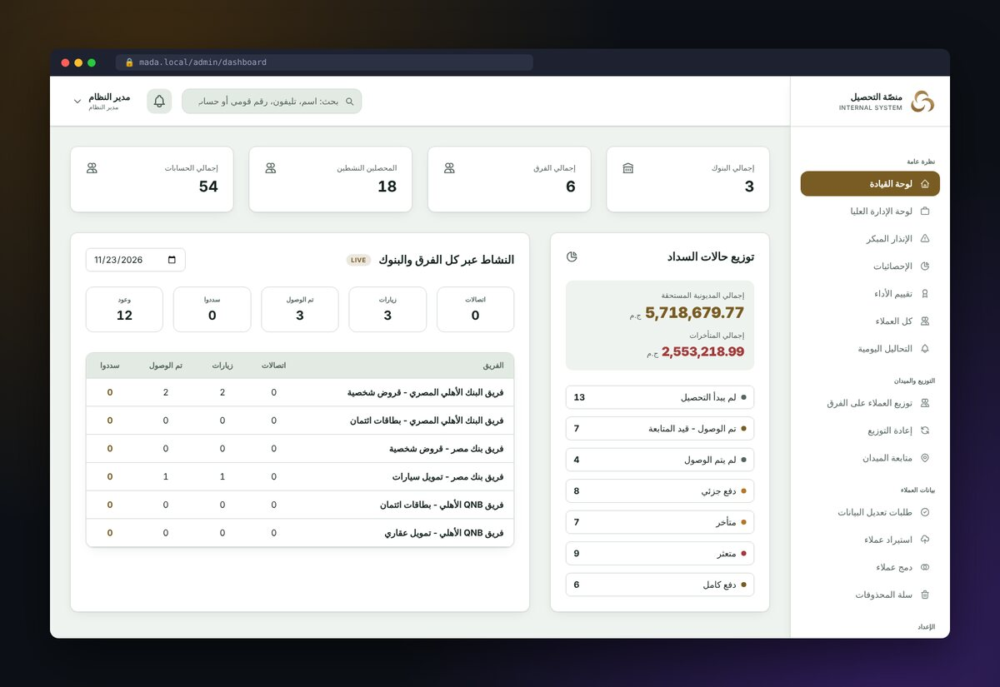</td>
    <td width="50%">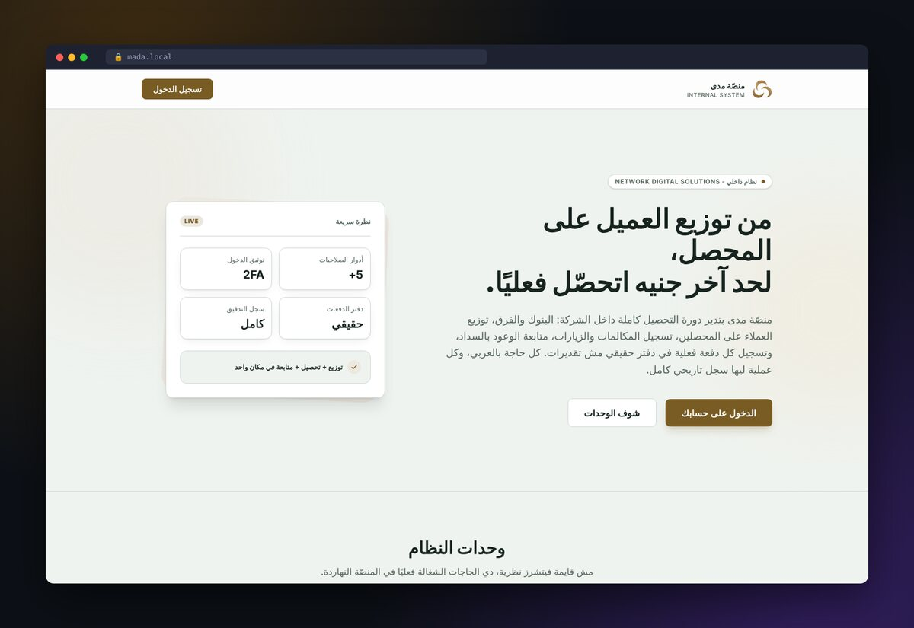</td>
  </tr>
</table>

- 📊 Leadership & executive dashboards, live team activity, collection-status breakdown and **early-warning** alerts
- 👥 Role-based workspaces for **collectors, supervisors, collection managers & reporting** (re-assignment, field sheets, team reports)
- 📝 Daily collector reports, payment promises, change requests and a **report builder** with Excel/PDF downloads
- 🔐 **Two-factor authentication**, audit trail and fine-grained permissions


---

### 🏭 NDS ERP | Factory Resource Planning
> A full Arabic (RTL) ERP for manufacturing plants. It covers production, maintenance, attendance and payroll, and is built on a **plugin architecture** where every business module is an independent package.

<table>
  <tr>
    <td width="50%">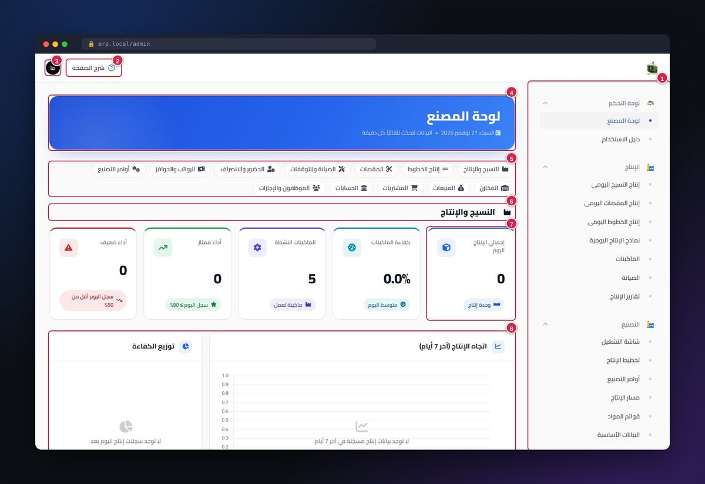</td>
    <td width="50%">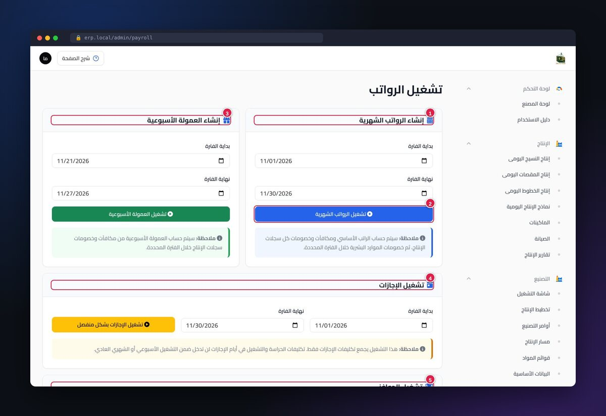</td>
  </tr>
</table>

- 🏗️ **Production:** daily production forms, per-employee output, machines & gears, production-cost reports
- 🛠️ **Maintenance:** maintenance forms, breakdowns, failure types and change review
- 🕒 **Attendance:** shift templates, work groups, scheduling, timesheets and **biometric device** integration
- 💰 **Payroll:** monthly & weekly runs, advances, loans, penalties and tax brackets, plus accounting, invoicing and inventory
- 🛡️ Roles & permissions with Filament Shield, plus a Pest test suite


---

### 🩺 Bimarist | Clinic Management System
> A connected platform for clinics covering patient records, appointments, clinical workspaces for 20+ specialties, prescriptions, inventory, billing and a patient portal.

<table>
  <tr>
    <td width="50%">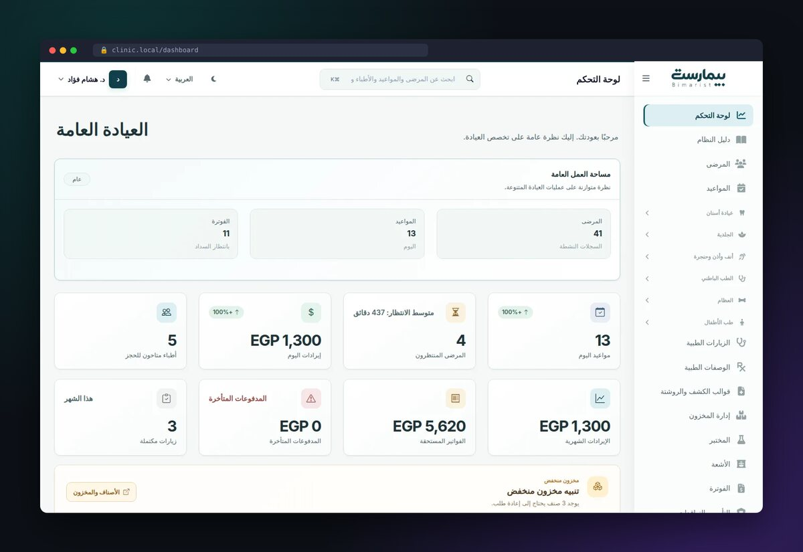</td>
    <td width="50%">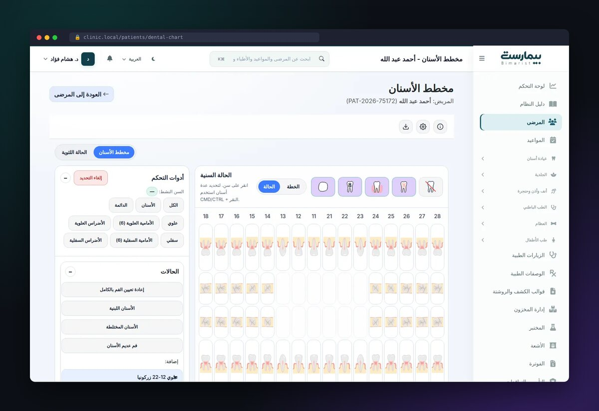</td>
  </tr>
</table>

- 🏥 Specialty workspaces (dental chart, cardiology, ophthalmology, orthopedics, pediatrics, body map…) with clinical templates
- 📅 Appointments calendar, waiting list, recalls, care plans and consents
- 💳 Billing, insurance, cash closing, commissions, expenses and inventory
- 🔌 Integrations (**FHIR**, **PACS**), real-time chat via Reverb, audit log and a **mobile API**


#### 🌐 Bimarist website & CRM: [bimarist.com](https://bimarist.com)
> The bilingual (Arabic/English) marketing site for the clinic system, with a built-in **CRM**. Every "book a demo" or contact request becomes a lead, organization and person in the CRM.

<table>
  <tr>
    <td width="50%">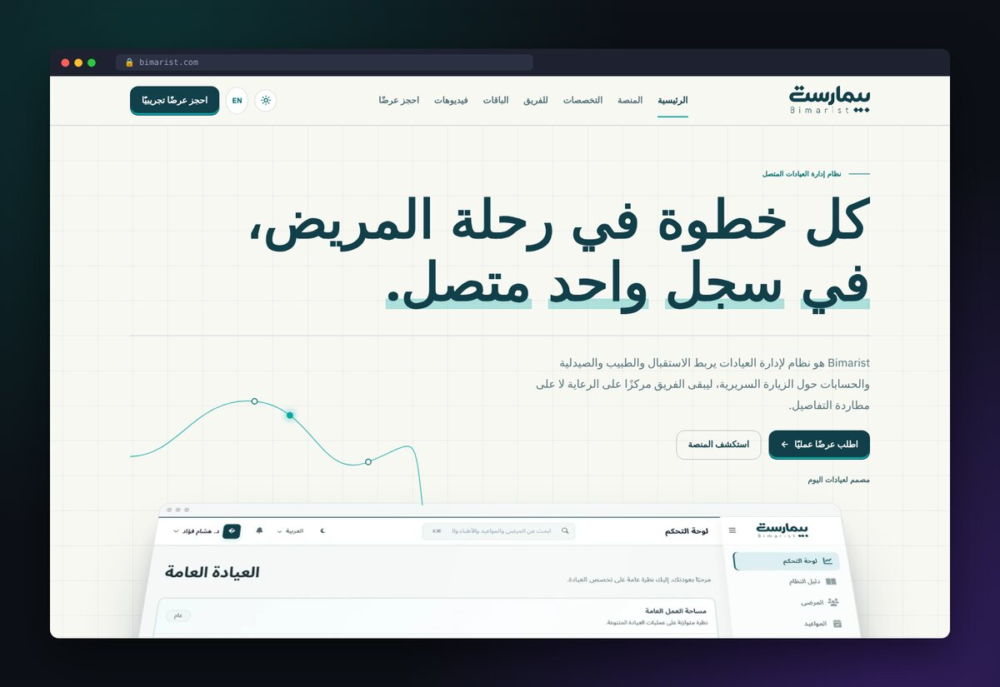</td>
    <td width="50%">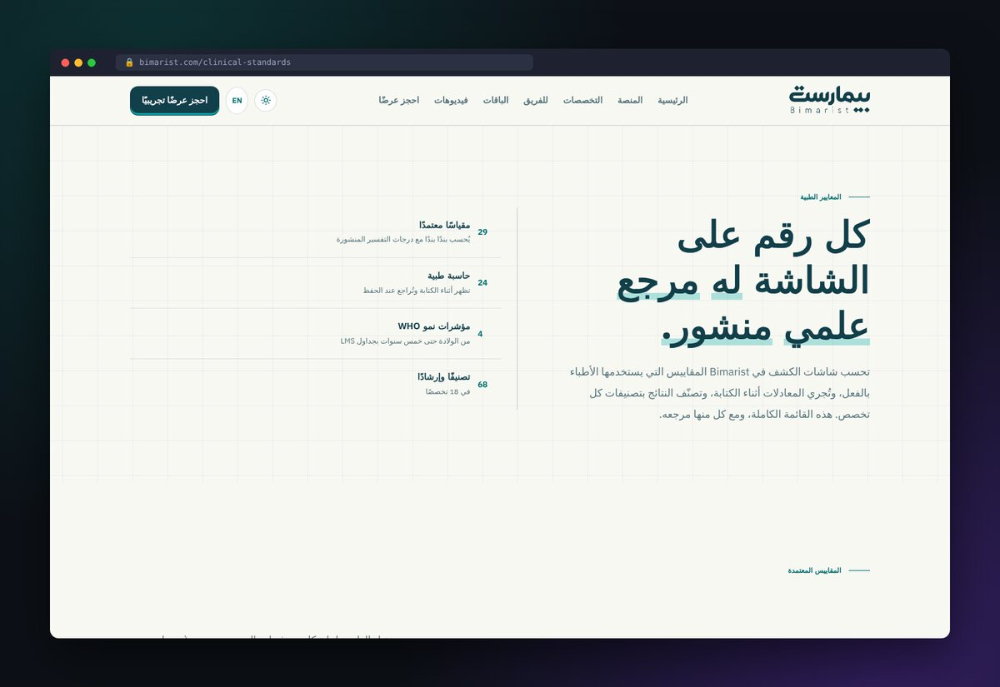</td>
  </tr>
</table>


---

<table>
  <tr>
    <td width="50%" valign="top">
      <h3>💼 Employment Center | Recruitment System</h3>
      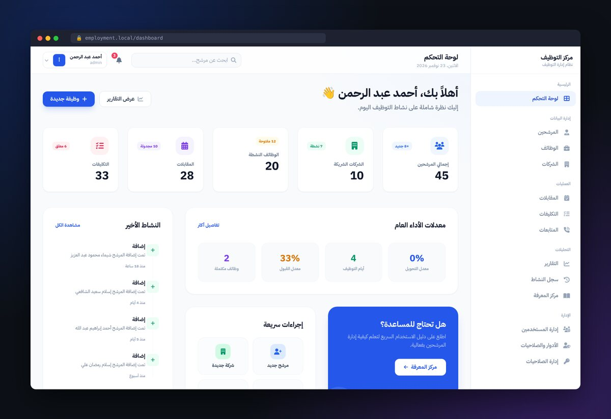
      <p>A complete recruitment management system: companies, job openings, candidates, assignments, interviews and follow-ups, with an intake form, Excel export, reports, a knowledge center and role-based access.</p>
      <p>
        
        
        
      </p>
    </td>
    <td width="50%" valign="top">
      <h3>🗂️ Archive System | Electronic Archiving</h3>
      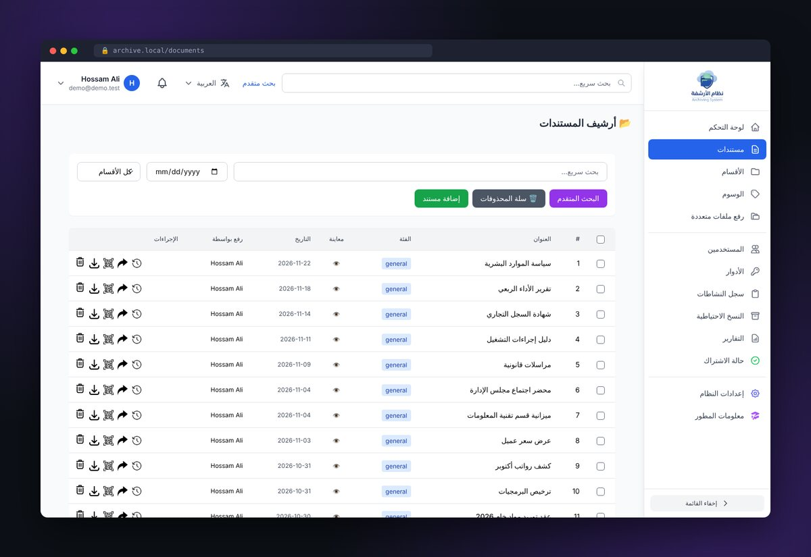
      <p>A secure document archive with sections, tags, folders, versioning, previews, advanced search, expiry alerts, sharing, trash, backups, audit logs, OTP and <b>WebAuthn (passkeys)</b> login, and subscription control.</p>
      <p>
        
        
        
      </p>
    </td>
  </tr>
  <tr>
    <td width="50%" valign="top">
      <h3>🌾 Elisraa | Agricultural Export</h3>
      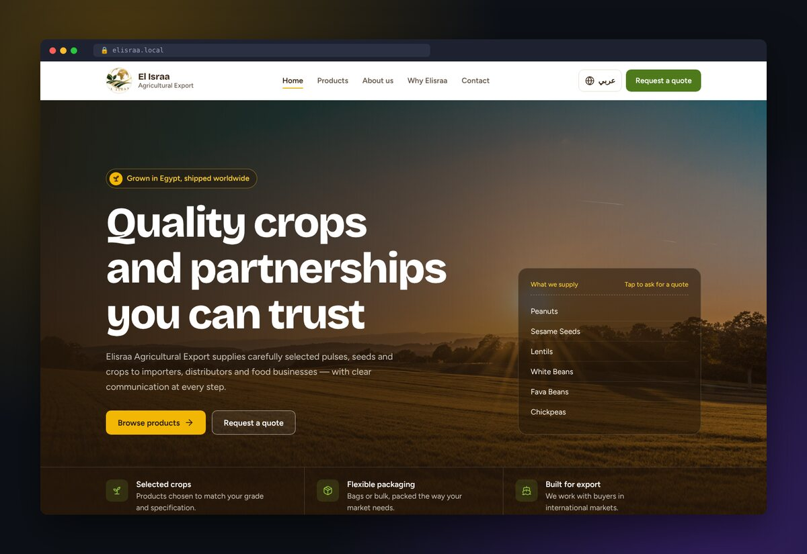
      <p>Bilingual website for an Egyptian agricultural export company (pulses, seeds, grains), with a quote-request flow and an Arabic admin dashboard for products, inquiries (with export), site texts, settings and users.</p>
      <p>
        
        
        
      </p>
    </td>
    <td width="50%" valign="top">
      <h3>🏛️ Rawasi | Heritage Building Assessment</h3>
      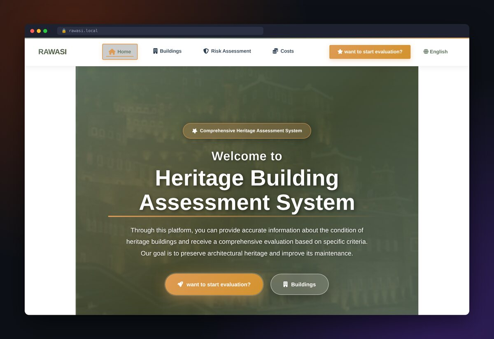
      <p>A platform for assessing heritage buildings through a multi-step building form (basic info, facilities, location, heritage), <b>risk-priority (RPN)</b> calculations and restoration-cost analysis with charts and export.</p>
      <p>
        
        
        
      </p>
    </td>
  </tr>
  <tr>
    <td width="50%" valign="top">
      <h3>🍽️ Italiano | Kitchens & Closets</h3>
      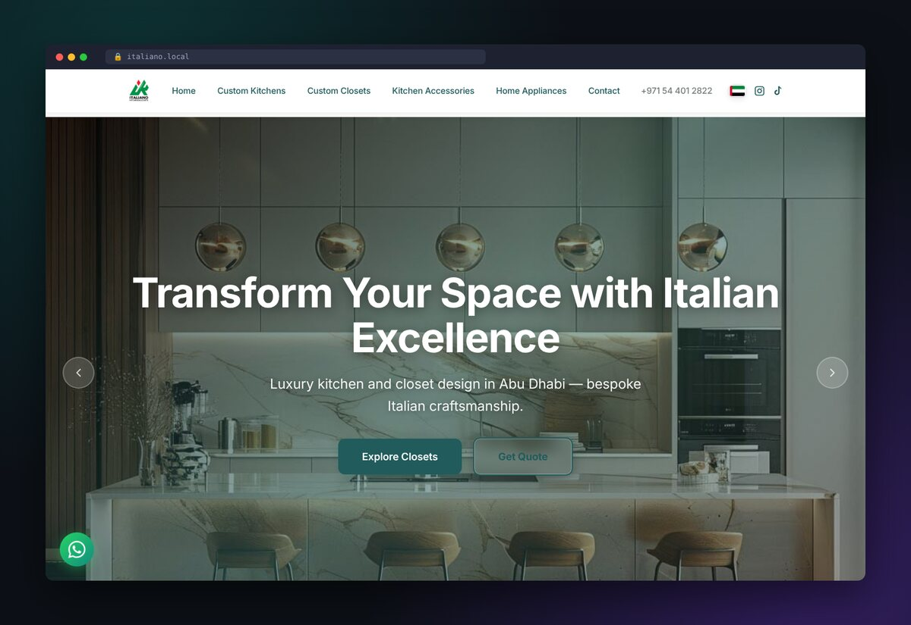
      <p>Showcase website for a luxury kitchen & closet company in Abu Dhabi: kitchens, closets, accessories and appliances catalogs, a portfolio, contact requests and an admin panel with visitor analytics.</p>
      <p>
        
        
        
      </p>
    </td>
    <td width="50%" valign="top">
      <h3>🌐 NDS | Network Digital Solutions</h3>
      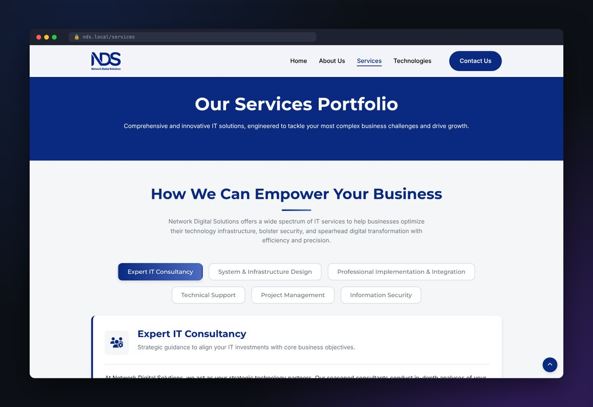
      <p>Corporate website for an IT solutions company: services portfolio (consultancy, infrastructure, integration, support, project management, information security), technologies, about and contact pages.</p>
      <p>
        
        
        
        
      </p>
    </td>
  </tr>
</table>

### 🎓 Swiss Edu | Online Learning Platform
> An LMS with a course catalog, instructors, curriculum with quizzes and progress tracking, course certificates and invoices, a blog, FAQ, coupons, push notifications and **8+ payment gateways** (PayPal, Paystack, Flutterwave, Razorpay, Mollie, Paytm, Mercado Pago, Instamojo).


### 🚌 School Bus Tracking System
> A platform for schools to track buses in real time and keep parents informed: a Laravel admin panel plus a REST API that powers separate **Driver** and **Parent** mobile apps. It manages schools, geofenced trips, vehicles, drivers, parents and children, and uses Passport + Sanctum, email 2FA and Pusher push notifications. Repos: [**bustracking**](https://github.com/HossamAli999/bustracking) · [**panel**](https://github.com/HossamAli999/panel)

---

<table>
  <tr>
    <td width="50%" valign="top">
      <h3>🏥 Hospital Management Dashboard</h3>
      <a href="https://github.com/HossamAli999/hospital">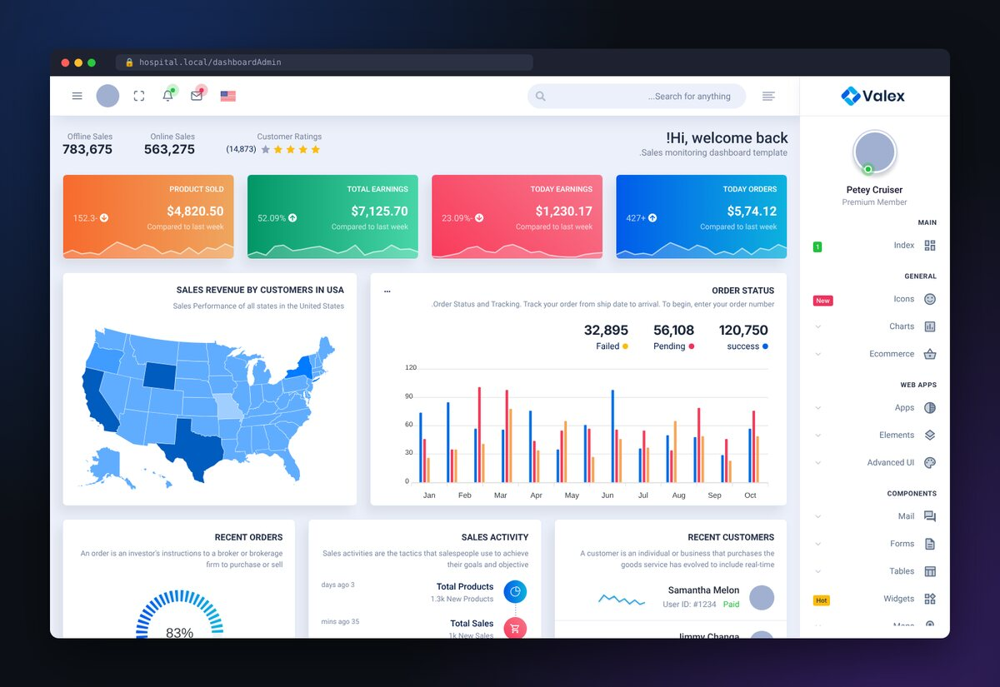</a>
      <p>Hospital admin platform with separate <b>admin</b> and <b>user</b> guards, multi-auth login (Arabic/English) and an analytics dashboard. <a href="https://github.com/HossamAli999/hospital">Repository →</a></p>
    </td>
    <td width="50%" valign="top">
      <h3>🙋 Personal Portfolio</h3>
      <a href="https://hossamali.me"></a>
      <p>My personal portfolio: about, resume and contact. <a href="https://hossamali.me">hossamali.me →</a></p>
    </td>
  </tr>
</table>

---

## 🗂️ More projects

| Project | Description | Stack |
|:--|:--|:--|
| [**Smart Appointment Form Manager**](https://github.com/HossamAli999/Smart-Appointment-Form-Manager) | Shareable booking/registration forms with date options, submission quotas and CSV export (Arabic-ready) | Laravel 12 · Breeze · Excel |
| [**POS System**](https://github.com/HossamAli999/pos-system) | Point-of-sale & business management: products, contacts, accounting, cash registers, barcodes, reports | Laravel 9 · Passport · DomPDF |
| [**My Accounts**](https://github.com/HossamAli999/My-Accounts-web-site) | Gather all your social accounts in one profile and share a single link with friends | Laravel 9 · Sanctum |

---

## 🛡️ Security focus

```text
┌──────────────────────────────┬──────────────────────────────────────────────┐
│ Secure Laravel apps          │ validation · sanitization · CSRF · policies  │
│ Authentication & AuthZ       │ Passport · Sanctum · 2FA · role-based access │
│ API hardening                │ rate limiting · scoped tokens · guards       │
│ Investigation                │ log analysis · brute-force & anomaly hunting │
│ Practice                     │ TryHackMe rooms · hands-on labs              │
└──────────────────────────────┴──────────────────────────────────────────────┘
```

<p align="center">
  <a href="https://tryhackme.com/p/hossamali"></a>
</p>

---

## 📊 GitHub stats

<p align="center">
  
  
</p>

<p align="center">
  
</p>

<p align="center">
  
</p>

---

<div align="center">

### ⚡ Fun fact
*I don't just write backend code… I think like a developer and investigate like a security analyst.*

<br/>

**Let's build something secure together →** [hossam.anber6@gmail.com](mailto:hossam.anber6@gmail.com)


</div>
