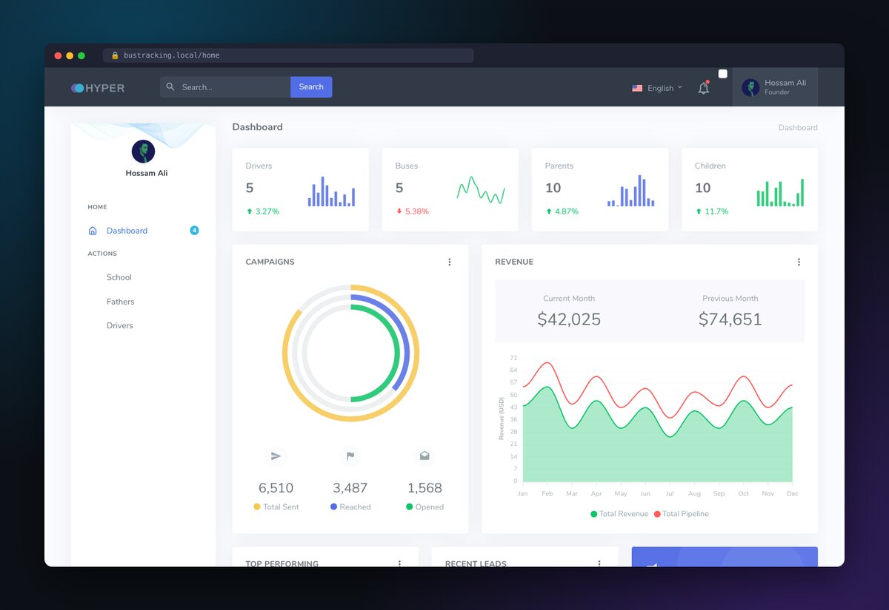
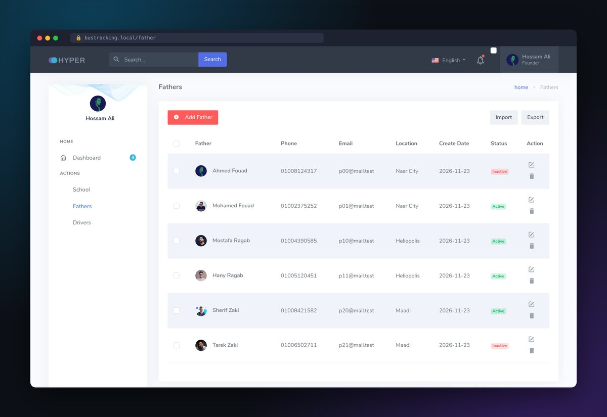
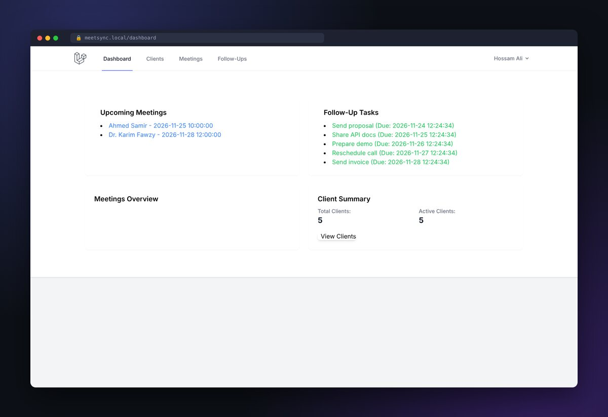
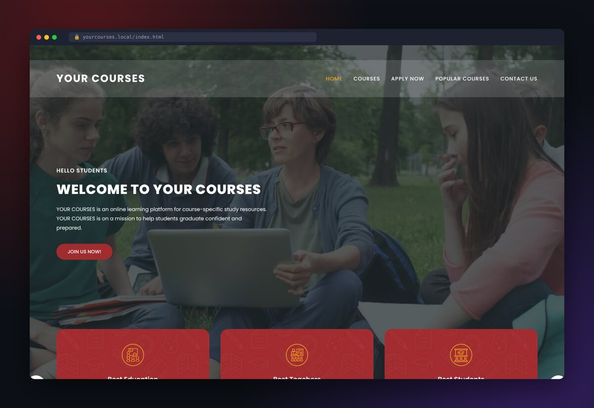
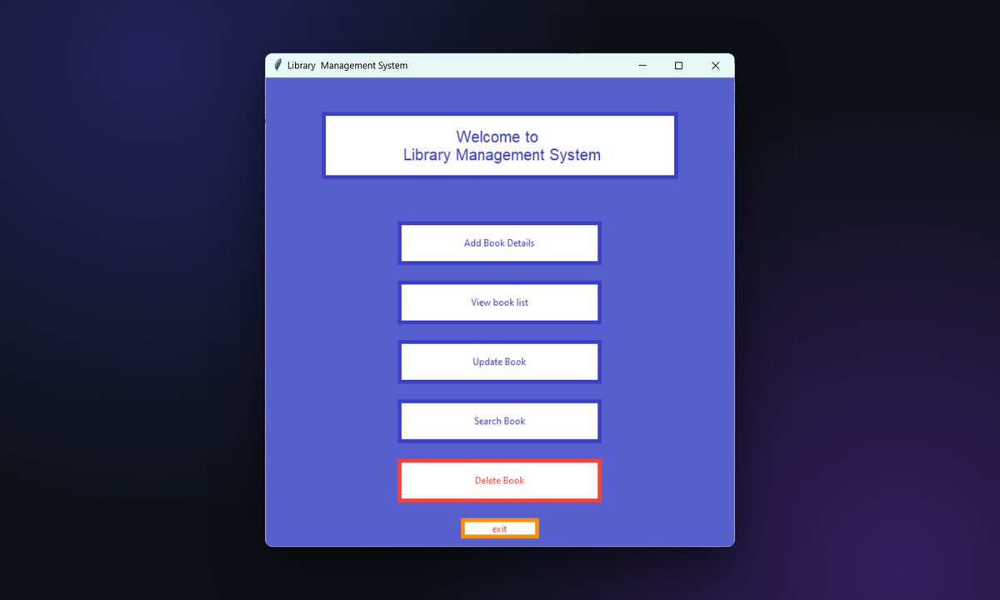
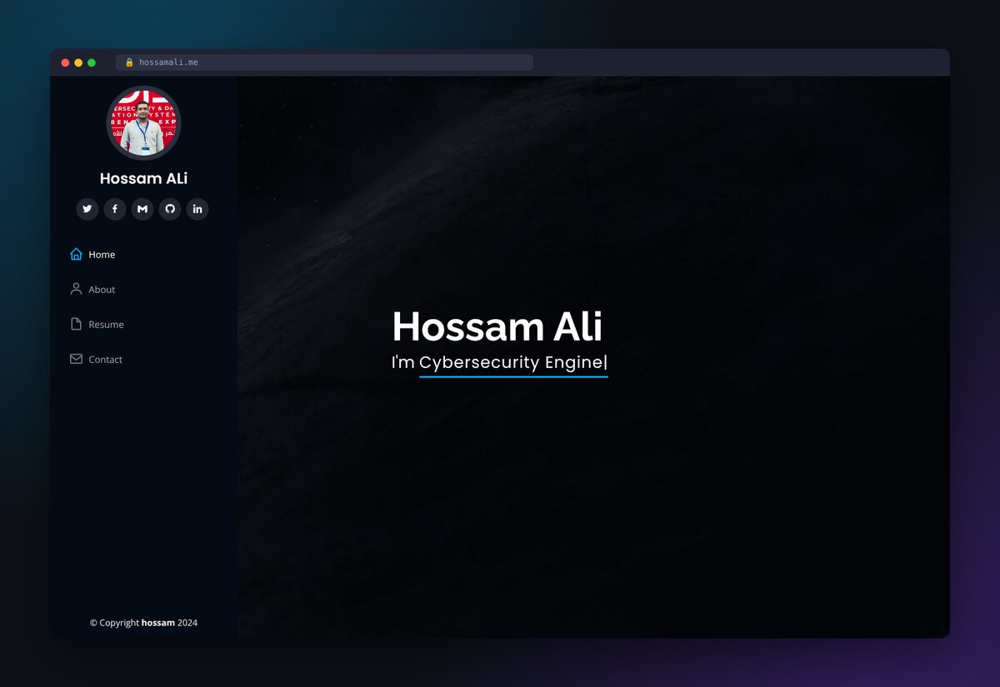

<div align="center">


<a href="https://git.io/typing-svg"></a>

<p>
  <a href="https://hossamali.me"></a>
  <a href="https://linkedin.com/in/hossamali6"></a>
  <a href="https://x.com/hossamali66"></a>
  <a href="mailto:hossam.anber6@gmail.com"></a>
  <a href="https://tryhackme.com/p/hossamali"></a>
</p>


</div>

---

## 👋 About me


I'm **Hossam Ali**, a self-taught **backend developer** from Egypt 🇪🇬 specialized in **Laravel & PHP**, with a strong focus on **cybersecurity**.

I build secure, scalable backend systems — and I like to understand how those systems behave under real-world load and real-world attacks.

- 🔧 Building **REST APIs**, admin dashboards and data-driven platforms with Laravel
- 🔐 Designing **authentication, authorization & RBAC** (Passport, Sanctum, 2FA)
- 🛡️ **Log analysis & attack investigation** — brute-force, suspicious activity, hardening
- 🧪 Practicing hands-on on **TryHackMe** & security labs
- 💼 **Open for freelance** backend work — [drop me an email](mailto:hossam.anber6@gmail.com)

<br clear="right" />

---

## 🧰 Tech stack

<p align="center">
  <br/>
  
</p>

<div align="center">

| Backend | Security | Data | Tooling |
|:--|:--|:--|:--|
| Laravel · PHP 8 · REST APIs | Auth & RBAC · 2FA · OWASP Top 10 | MySQL · SQLite · Eloquent | Git · Linux · Postman |
| Passport · Sanctum · Breeze | Log analysis · Brute-force detection | Excel import/export · Reports | Composer · Vite · npm |
| Queues · Notifications · Pusher | Input validation · Secure sessions | PDF & barcode generation | TryHackMe labs |

</div>

---

## 🚀 Featured projects

### 🚌 School Bus Tracking System
> A complete platform for schools to track buses in real time and keep parents informed — a Laravel admin panel + REST API that powers separate **Driver** and **Parent** mobile apps.

<table>
  <tr>
    <td width="50%"></td>
    <td width="50%"></td>
  </tr>
</table>

- 🗺️ Schools, trips, geofenced routes, vehicles, drivers, parents & children management
- 📱 Dedicated API guards for **drivers** and **parents** (`trip/start`, `trip/delivered`, `trip/end`, attendance…)
- 🔐 Laravel **Passport** + **Sanctum**, **email two-factor authentication**, verified accounts
- 🔔 Real-time updates & push notifications via **Pusher**


&nbsp;→&nbsp; [**bustracking**](https://github.com/HossamAli999/bustracking) · [**panel**](https://github.com/HossamAli999/panel)

---

<table>
  <tr>
    <td width="50%" valign="top">
      <h3>🏥 Hospital Management Dashboard</h3>
      <a href="https://github.com/HossamAli999/hospital"></a>
      <p>Hospital admin platform with separate <b>admin</b> and <b>user</b> guards, multi-auth login flow (Arabic/English) and a rich analytics dashboard.</p>
      <p>
        
        
        
      </p>
      <a href="https://github.com/HossamAli999/hospital"><b>View repository →</b></a>
    </td>
    <td width="50%" valign="top">
      <h3>📅 MeetSync</h3>
      <a href="https://github.com/HossamAli999/MeetSync"></a>
      <p>Client meeting & follow-up manager: clients CRUD, meeting scheduler with status & attachments, follow-up tasks and an overview dashboard.</p>
      <p>
        
        
        
      </p>
      <a href="https://github.com/HossamAli999/MeetSync"><b>View repository →</b></a>
    </td>
  </tr>
  <tr>
    <td width="50%" valign="top">
      <h3>🎓 Your Courses</h3>
      <a href="https://github.com/HossamAli999/YourCources"></a>
      <p>Responsive education website — courses catalog, meetings/events pages, application flow and contact section.</p>
      <p>
        
        
        
        
      </p>
      <a href="https://github.com/HossamAli999/YourCources"><b>View repository →</b></a>
    </td>
    <td width="50%" valign="top">
      <h3>📚 Library Management System</h3>
      <a href="https://github.com/HossamAli999/Python-tkinter-GUI-library"></a>
      <p>Desktop app to add, view, update, search and delete books — built with Python and a Tkinter GUI.</p>
      <p>
        
        
        
      </p>
      <a href="https://github.com/HossamAli999/Python-tkinter-GUI-library"><b>View repository →</b></a>
    </td>
  </tr>
</table>

### 🌐 Personal Portfolio — [hossamali.me](https://hossamali.me)

<a href="https://hossamali.me"></a>

---

## 🗂️ More projects

| Project | Description | Stack |
|:--|:--|:--|
| [**Smart Appointment Form Manager**](https://github.com/HossamAli999/Smart-Appointment-Form-Manager) | Shareable booking/registration forms with date options, submission quotas and CSV export (Arabic-ready) | Laravel 12 · Breeze · Excel |
| [**POS System**](https://github.com/HossamAli999/pos-system) | Point-of-sale & business management: products, contacts, accounting, cash registers, barcodes, reports | Laravel 9 · Passport · DomPDF |
| [**My Accounts**](https://github.com/HossamAli999/My-Accounts-web-site) | Gather all your social accounts in one profile and share a single link with friends | Laravel 9 · Sanctum |
| [**Bus Tracking — Panel**](https://github.com/HossamAli999/panel) | Earlier version of the bus tracking admin panel | Laravel 8 · Pusher |

> 🔒 Plus private & client work: **ERP / payroll** systems, a **central identity (SSO) server**, **clinic management**, a **digital security score** platform and **Flutter** mobile apps.

---

## 🛡️ Security focus

```text
┌──────────────────────────────┬──────────────────────────────────────────────┐
│ Secure Laravel apps          │ validation · sanitization · CSRF · policies  │
│ Authentication & AuthZ       │ Passport · Sanctum · 2FA · role-based access │
│ API hardening                │ rate limiting · scoped tokens · guards       │
│ Investigation                │ log analysis · brute-force & anomaly hunting │
│ Practice                     │ TryHackMe rooms · hands-on labs              │
└──────────────────────────────┴──────────────────────────────────────────────┘
```

<p align="center">
  <a href="https://tryhackme.com/p/hossamali"></a>
</p>

---

## 📊 GitHub stats

<p align="center">
  
  
</p>

<p align="center">
  
</p>

<p align="center">
  
</p>

---

<div align="center">

### ⚡ Fun fact
*I don't just write backend code… I think like a developer and investigate like a security analyst.*

<br/>

**Let's build something secure together →** [hossam.anber6@gmail.com](mailto:hossam.anber6@gmail.com)


</div>
